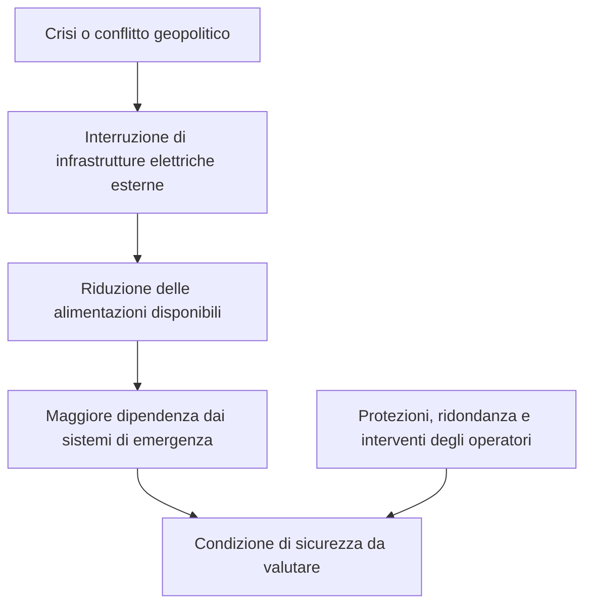
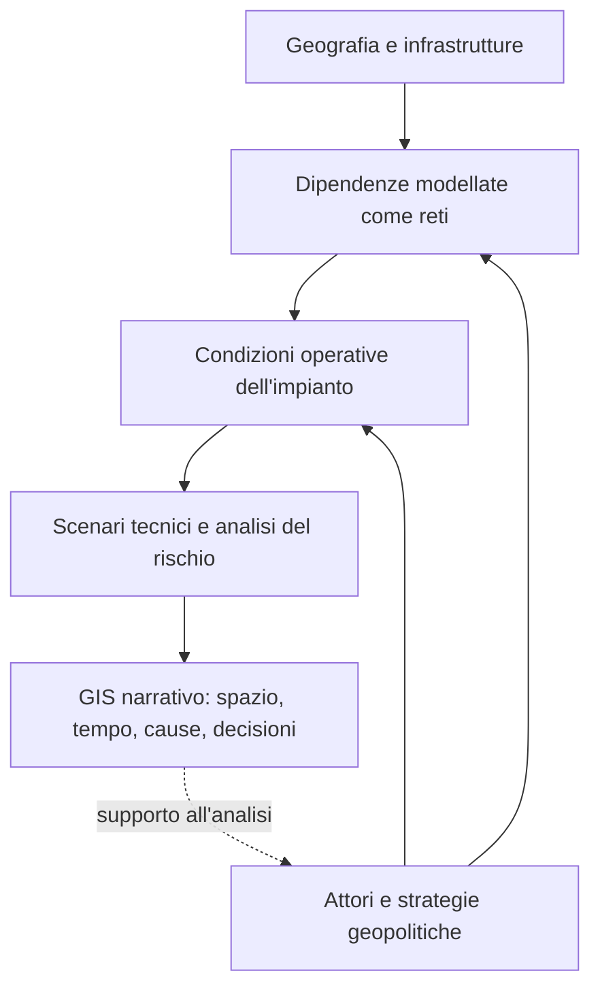

# Sicurezza dell'energia nucleare: dimensioni tecniche e geopolitiche

> **Progetto GIS narrativo — Documento di inquadramento**  
> Obiettivo: descrivere come le dinamiche geopolitiche incidano sulle condizioni tecniche di sicurezza degli impianti nucleari e come tali interazioni possano essere analizzate mediante un GIS narrativo.

## 1. Il problema

La sicurezza di una centrale nucleare non dipende soltanto dalla progettazione e dalla gestione dell'impianto: dipende anche dalla stabilità delle reti infrastrutturali, delle catene di fornitura e del contesto istituzionale e geopolitico in cui opera.

**Domanda guida:** in che modo una decisione politica, una crisi internazionale o un evento bellico possono modificare le condizioni tecniche di sicurezza di un impianto nucleare? E, in senso inverso, come possono i vincoli tecnici dell'impianto influenzare decisioni e negoziati geopolitici?

## 2. Quattro dimensioni della sicurezza nucleare

| Dimensione | Problema fondamentale | Discipline coinvolte |
|---|---|---|
| **Sicurezza tecnica (*nuclear safety*)** | Prevenire incidenti, controllare la reattività, assicurare il raffreddamento del combustibile e contenere le sostanze radioattive. | Fisica nucleare, termoidraulica, ingegneria, affidabilità. |
| **Protezione fisica e informatica (*nuclear security*)** | Prevenire e contrastare atti intenzionali, accessi non autorizzati, sabotaggi e attacchi informatici. | Sicurezza fisica, cybersecurity, analisi delle minacce. |
| **Verifiche di non proliferazione (*safeguards*)** | Verificare che materiali e attività nucleari sottoposti a salvaguardie non siano deviati verso usi non dichiarati o militari. | Fisica nucleare, metrologia, controlli internazionali, diplomazia. |
| **Sicurezza dell'approvvigionamento energetico (*energy security*)** | Garantire continuità e sostenibilità delle forniture di combustibile, componenti, servizi ed energia. | Economia, logistica, geopolitica, teoria delle reti. |

> **Nota terminologica:** *safety*, *security* e *safeguards* sono ambiti distinti della governance nucleare. La sicurezza energetica è una dimensione connessa, ma non coincide con essi.

## 3. Connessioni fra tecnica e geopolitica

| Problema tecnico | Dimensione geopolitica | Strumenti teorici e metodologici |
|---|---|---|
| Disponibilità di uranio, conversione, arricchimento e fabbricazione del combustibile | Concentrazione dei fornitori, dipendenze commerciali, sanzioni, interruzioni delle forniture. | Teoria dei giochi; reti commerciali; analisi della resilienza delle filiere. |
| Alimentazione elettrica dei sistemi di sicurezza | Stabilità della rete, conflitti armati, interruzione delle infrastrutture esterne. | Teoria delle reti; affidabilità; analisi di scenari. |
| Raffreddamento del reattore e del combustibile esaurito | Disponibilità idrica, siccità, eventi estremi, conflitti territoriali. | Termoidraulica; modellazione ambientale; sistemi complessi. |
| Controllo, ispezione e manutenzione | Capacità delle istituzioni, continuità delle competenze, dipendenza da ricambi e tecnologie. | Teoria delle decisioni; analisi del rischio; logistica. |
| Protezione degli impianti | Conflitti, minacce intenzionali, deterrenza, coordinamento internazionale. | Teoria dei giochi; analisi delle minacce; gestione delle crisi. |
| Gestione delle emergenze | Effetti transfrontalieri, cooperazione, comunicazione pubblica e responsabilità internazionali. | Modelli probabilistici; GIS; modellazione della dispersione; pianificazione delle emergenze. |
| Materiali e tecnologie a duplice uso | Rischi di proliferazione, controlli internazionali, accordi e verifiche. | Giochi a informazione incompleta; teoria dei segnali; analisi istituzionale. |

## 4. Le basi teoriche

| Disciplina | Concetti fondamentali | Applicazione al problema nucleare |
|---|---|---|
| **Teoria dei giochi** | Equilibrio di Nash, cooperazione, deterrenza, informazione incompleta, giochi ripetuti. | Comportamento degli Stati durante crisi, accordi di protezione e accesso, negoziati. |
| **Teoria delle reti e dei grafi** | Connettività, centralità, ridondanza, dipendenze e reti multilivello. | Studio delle connessioni tra centrali, rete elettrica, acqua, trasporti e filiere. |
| **Teoria dei sistemi complessi** | Retroazioni, non linearità, propagazione delle perturbazioni, effetti a cascata. | Analisi della propagazione di una crisi tra sistemi tecnici, economici e istituzionali. |
| **Teoria delle decisioni** | Utilità, incertezza, criteri multipli, razionalità limitata. | Scelte di gestione delle crisi e priorità di protezione. |
| **Teoria dell'informazione** | Incertezza, segnali, informazione asimmetrica. | Comunicazione, trasparenza, valutazione delle informazioni durante una crisi. |
| **Probabilità e analisi del rischio** | Scenari, affidabilità, probabilità condizionate, inferenza bayesiana. | Valutazione di scenari di perdita delle funzioni di sicurezza e delle misure di mitigazione. |

Questi approcci sono complementari: **i giochi descrivono le scelte degli attori**, **le reti descrivono le dipendenze**, **l'ingegneria descrive le condizioni operative** e **l'analisi del rischio descrive l'incertezza e le conseguenze possibili**.

## 5. Caso di studio: centrale nucleare di Zaporižžja

La centrale di Zaporižžja, in Ucraina, costituisce un caso emblematico per studiare il rapporto tra conflitto armato e sicurezza nucleare.

Anche con i reattori spenti, il combustibile continua a produrre **calore di decadimento**: occorrono quindi sistemi di raffreddamento affidabili e alimentazioni elettriche adeguate. L'indisponibilità di collegamenti alla rete esterna può aumentare la dipendenza dalle fonti di alimentazione di emergenza e ridurre i margini di ridondanza.

### Catena causale *ipotetica* da analizzare

**Attenzione:** il diagramma non descrive un incidente inevitabile, né costituisce una valutazione dello stato attuale della centrale. Gli esiti dipendono da configurazione dell'impianto, protezioni disponibili, durata degli eventi e capacità di risposta.

## 6. Teoria dei giochi: modello qualitativo iniziale

Si considerino, in forma semplificata, due Stati che decidono se cooperare per garantire interventi tecnici su infrastrutture essenziali per la sicurezza di un impianto.

| | **Stato B coopera** | **Stato B non coopera** |
|---|---|---|
| **Stato A coopera** | Maggiori possibilità di intervento; beneficio condiviso per la sicurezza. | Cooperazione incompleta; rischio persistente. |
| **Stato A non coopera** | Cooperazione incompleta; rischio persistente. | Ostacoli agli interventi e possibili costi per entrambi. |

Questa tabella è **illustrativa, non una matrice di payoff quantitativi**. Per formalizzare il gioco occorre specificare gli attori, le strategie realmente disponibili, l'informazione di ciascuno, i payoff, la sequenza temporale e l'eventuale mediazione internazionale.

## 7. Struttura proposta per il GIS narrativo

| Livello | Entità e dati | Domanda a cui risponde |
|---|---|---|
| **Geografico** | Impianti, reti elettriche, risorse idriche, trasporti, confini, filiere. | Dove si trovano risorse, infrastrutture e connessioni? |
| **Geopolitico** | Stati, accordi, conflitti, istituzioni, decisioni, dipendenze. | Quali attori influenzano il funzionamento del sistema? |
| **Tecnico** | Stato degli impianti, alimentazioni, raffreddamento, barriere, ridondanza. | Quali funzioni devono essere preservate per mantenere la sicurezza? |
| **Dinamico e narrativo** | Sequenze temporali, eventi, scenari, simulazioni e interventi. | Come si propaga una crisi e come cambiano gli esiti possibili? |

### Collegamento fra i livelli

Nel GIS occorre distinguere sempre **fatti osservati**, **ipotesi di modellazione**, **scenari simulati** e **incertezze**.

## 8. Domanda di ricerca e primo perimetro operativo

> **In che modo le dinamiche geopolitiche modificano le condizioni tecniche di sicurezza degli impianti nucleari e come rappresentare e analizzare queste interazioni attraverso un GIS narrativo?**

Il problema può essere affrontato in due direzioni:

1. **Dalla geopolitica alla tecnica:** come conflitti, sanzioni e crisi delle infrastrutture modificano le condizioni operative di un impianto.
2. **Dalla tecnica alla geopolitica:** come i vincoli fisici e ingegneristici dell'impianto influenzano strategie, negoziazioni e cooperazione internazionale.

**Primo caso applicativo proposto:** continuità dell'alimentazione elettrica di una centrale nucleare in un territorio interessato da un conflitto, studiata mediante teoria dei giochi, teoria delle reti e ingegneria della sicurezza.

## Riferimenti per approfondire

- [IAEA — Nuclear Safety and Security](https://www.iaea.org/topics/nuclear-safety-and-security)
- [IAEA — Safeguards and Verification](https://www.iaea.org/topics/safeguards-and-verification)
- [IAEA — Zaporizhzhya Nuclear Power Plant](https://www.iaea.org/topics/response/nuclear-safety-security-and-safeguards-in-ukraine)
- [IEA — Nuclear Energy](https://www.iea.org/energy-system/electricity/nuclear-power)

*Documento di inquadramento concettuale. Non sostituisce analisi tecniche di sicurezza nucleare, valutazioni regolatorie o informazioni operative verificate sullo stato degli impianti.*
